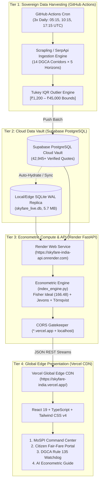
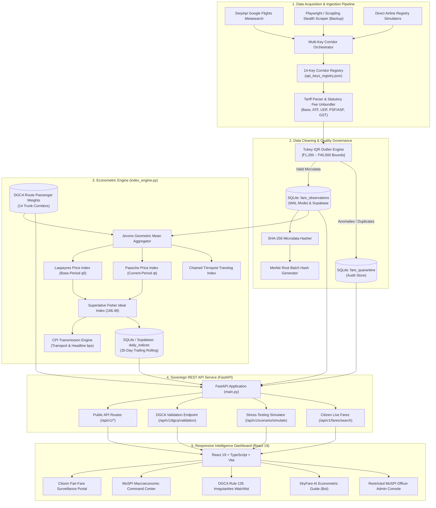
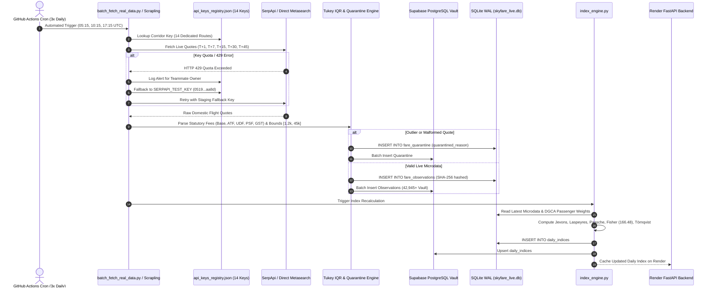
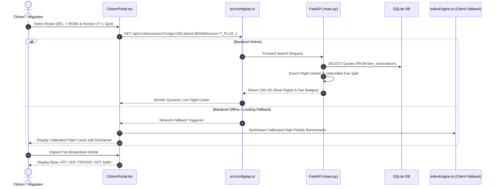

# 🏗️ System Architecture & Engineering Blueprint — SkyFare India
## National Airfare Intelligence Platform & Sovereign Economic Surveillance Engine

* **System Name**: SkyFare India Architecture & Flow Blueprint
* **Architecture Pattern**: 4-Tier Sovereign Cloud Mesh (GitHub Actions Ingestion $\rightarrow$ Supabase PostgreSQL Vault $\rightarrow$ Render FastAPI Microservice $\rightarrow$ Vercel React 19 Edge CDN)
* **Version**: `2.0.0 (Production Live)`
* **Last Updated**: `2026-10-16`
* **Production Frontend**: `https://skyfare-india.vercel.app/`
* **Production Backend API**: `https://skyfare-india-api.onrender.com`
* **Sovereign Database**: Supabase PostgreSQL (`lrgskbmrgtmcybqabrze.supabase.co`) & SQLite WAL replica (`skyfare_live.db`)

---

## 1. 🌐 High-Level System Architecture & 4-Tier Cloud Mesh

SkyFare India operates across a sovereign 4-tier decoupled cloud infrastructure ensuring 100% automated harvesting, cryptographic tamper resistance, zero-downtime serving, and sub-100ms global response times:



### 1.1 Microdata Pipeline Decomposition



---

## 2. 🔄 Application Flow & Execution Lifecycles

### 2.1 Ingestion & Index Generation Lifecycle


### 2.2 Citizen Search & Regulatory Surveillance Lifecycle


---

## 3. 💻 Technology Stack & Component Matrix

| Layer | Technology | Version | Purpose & Rationale |
| :--- | :--- | :---: | :--- |
| **Frontend Framework** | React | `19.0.1` | Ultra-fast concurrent rendering, native transitions, high-frequency state updates. |
| **Language (Web)** | TypeScript | `5.8.2` | Full static type safety across economic indices, corridors, and API schemas. |
| **Build Tooling** | Vite | `6.2.3` | Instant HMR, tree-shaking, and lightweight production bundle generation ($< 4\text{s}$). |
| **Styling & Design** | Tailwind CSS | `4.1.14` | Modern utility-first CSS with CSS variables, `@custom-variant dark`, and fluid grid breakpoints. |
| **Iconography** | Lucide React | `0.546.0` | Crisp, scalable SVG icons for sovereign dashboards. |
| **Maps & Geo** | Leaflet & React Leaflet | `1.9.4` | High-performance interactive corridor route mapping across Indian airports. |
| **Motion & FX** | Motion (Framer Motion) | `12.23.24` | Smooth transitions for drawers, modals, and tab switches without frame drops. |
| **Backend Framework** | FastAPI | `0.110+` | Asynchronous REST API service with automatic OpenAPI documentation. |
| **Language (Server)**| Python | `3.10+` | High precision econometric computations (`math`, `datetime`, `sqlite3`, `re`). |
| **Database** | SQLite (WAL Mode) | `3.40+` | Sovereign, zero-configuration relational store with Write-Ahead Logging for high concurrency. |
| **Scraping Engine** | Requests & SerpApi | `2.31+` | Resilient HTTP clients for Google Flights API with multi-key round-robin routing. |
| **AI / NLP Guide** | Custom Rule-NLP Router | Native TS | Grounded, deterministic 22-module econometric policy guide with zero hallucination. |
| **Testing** | Python `unittest` | Native | 16/16 automated test suites covering data quality, DGCA validation, and key registry. |

---

## 4. 📁 Complete Project Folder & File Structure

```
c:/Compition/skyfare-india-—-national-airfare-intelligence (7)/
│
├── 📄 PRD.md                         # Product Requirement Document (Features, Users, Specs)
├── 📄 Architecture.md                # System Architecture, Flow & Tech Blueprint (This Document)
├── 📄 Rules.md                       # SIH Rules, Do's and Don'ts, Constraints & Best Practices
├── 📄 Design.md                      # UI/UX Design System, Color Tokens, Typography, Breakpoints
├── 📄 Update.md                      # Active Backlog, Pending Roadmap, and Deferred Fixes
├── 📄 README.md                      # Official Sovereign Project Documentation & Audit Log
│
├── ⚙️ Configuration & Environment
│   ├── .env                          # Local environment secrets & SerpApi keys (Git-ignored)
│   ├── .env.example                  # Template showing corridor-specific key variables
│   ├── .gitignore                    # Git exclusion rules (.venv, .env, DB binaries, node_modules)
│   ├── package.json                  # Frontend dependencies and npm scripts
│   ├── tsconfig.json                 # TypeScript compiler configurations
│   ├── vite.config.ts                # Vite bundler configuration with Tailwind plugin
│   ├── netlify.toml                  # Cloud deployment configuration for frontend
│   └── render.yaml                   # Backend deployment service definition
│
├── 🗄️ Backend & Data Pipeline
│   ├── main.py                       # FastAPI application entrypoint with all REST endpoints
│   ├── database.py                   # SQLite schema initialization, table seeding, and query layer
│   ├── schema.sql                    # Pure DDL script defining all relational tables and indexes
│   ├── skyfare_live.db               # SQLite database file (WAL mode enabled)
│   ├── index_engine.py               # Python econometric calculation engine (Jevons, Laspeyres, Fisher)
│   ├── scraper.py                    # Multi-source scraper with Tukey IQR outlier filter
│   ├── fetch_real_data.py            # Single-corridor live scraper using dedicated corridor key
│   ├── batch_fetch_real_data.py      # Multi-corridor batch scraper (14 corridors × 5 horizons)
│   ├── verify_all_keys.py            # Automated health-check script verifying all 14 SerpApi keys
│   ├── api_keys_registry.json        # 14-corridor dedicated key registry with teammate attribution
│   ├── purge_legacy_seed_data.py     # 45-day transition tool to purge pre-epoch seed data
│   ├── run_project.bat               # 1-click Windows launcher for Backend + Frontend
│   └── requirements.txt              # Python server and data dependencies
│
├── 🧪 Automated Test Suite
│   └── tests/
│       ├── __init__.py
│       ├── test_data_quality.py      # Tests for Tukey IQR bounds, unbundling, and duplicate rejects
│       └── test_dgca_and_weights.py  # Tests for 14 corridor weights, Fisher math, and key registry
│
├── 🌐 Frontend Application (`src/`)
│   ├── App.tsx                       # Master layout shell: sidebar, topbar, view routing, modals
│   ├── main.tsx                      # React root entrypoint mounting to DOM
│   ├── index.css                     # Tailwind CSS v4 imports, dark mode variant, font classes
│   ├── vite-env.d.ts                 # TypeScript ambient environment declarations
│   │
│   ├── 🧩 Components (`src/components/`)
│   │   ├── TopAppBar.tsx             # Government tricolor header, search trigger, theme toggle
│   │   ├── Sidebar.tsx               # Responsive navigation drawer with live index badge
│   │   ├── CitizenPortal.tsx         # Citizen search console, dynamic flight cards, fee splits
│   │   ├── NationalIndexOverview.tsx # 5-Formula side-by-side benchmark & substitution gap
│   │   ├── RouteIntelligencePanel.tsx# 14-corridor yield table, Rule 135 status, and matrix
│   │   ├── BookingHorizonsPanel.tsx  # Advance booking curves (T+1 to T+45) & fleet HHI (4,680)
│   │   ├── IndiaCorridorHeatmap.tsx  # Interactive Leaflet map & spatial pricing pressure
│   │   ├── AnomalyWatchlistPanel.tsx # DGCA Rule 135 compliance ribbon & Festive Surge Watch
│   │   ├── CpiDecompositionPanel.tsx # Waterfall chart of corridor inflation transmission
│   │   ├── ScenarioSimulatorView.tsx # Policy stress simulator (ATF, grounding, demand shocks)
│   │   ├── PolicyChatbotView.tsx     # Grounded SkyFare AI Econometric Guide (22+ modules)
│   │   ├── AdminDashboard.tsx        # Restricted MoSPI Officer console (Scraper, Quarantine, Export)
│   │   ├── AdminLoginModal.tsx       # Secure authentication modal for MoSPI statistical officers
│   │   ├── FareInspectionModal.tsx   # Unbundled statutory fee decomposition breakdown modal
│   │   ├── MospiBulletinModal.tsx    # Official MoSPI macroeconomic monthly bulletin viewer
│   │   ├── QuickSearchModal.tsx      # Global Cmd/Ctrl+K search modal across all routes & views
│   │   ├── SupportView.tsx           # Help documentation, FAQs, and regulatory contact points
│   │   └── AboutView.tsx             # System provenance, architecture summary, and SIH credits
│   │
│   ├── ⚙️ Configuration & Infrastructure (`src/config/`, `src/db/`, `src/engine/`)
│   │   ├── api.ts                    # Dynamic backend URL resolver with staging fallbacks
│   │   ├── database.ts               # Client-side SQLite wrapper and offline cache
│   │   └── indexEngine.ts            # Client-side mirror of the 5-formula econometric engine
│   │
│   ├── 📦 Types & Mock Data (`src/types/`, `src/data/`, `src/utils/`)
│   │   ├── types/index.ts            # Complete TypeScript interface declarations
│   │   ├── data/mockData.ts          # Calibrated benchmark data, airports, and fallback routes
│   │   ├── data/indiaMapPaths.ts     # SVG GeoJSON vector coordinate paths for Indian states
│   │   └── utils/useIsMobile.ts      # Custom hook detecting viewport breakpoints dynamically
```

---

## 5. 🗄️ Database Architecture & Relational Schema

SkyFare India operates on a zero-overhead, high-performance SQLite engine configured with **Write-Ahead Logging (WAL)**:
`PRAGMA journal_mode=WAL; PRAGMA synchronous=NORMAL;`

### 5.1 Relational Tables
1. **`route_weights`**:
   - Stores the 14 official DGCA Category-I trunk corridors with annual passenger volumes ($q_0, q_t$), relative weights, distance in kilometers, and published tariff ceiling/floor bands.
2. **`fare_observations`**:
   - Granular flight microdata quotes containing `observed_at`, `origin`, `destination`, `carrier`, `flight_number`, `booking_horizon`, `fare`, unbundled fees (`base_fare`, `fuel_surcharge`, `airport_fee`, `gst`), and cryptographic hash.
3. **`fare_quarantine`**:
   - Rejection isolation table logging quotes flagged by Tukey's IQR filter, extreme bounds ($< ₹1,200$ or $> ₹45,000$), or duplicate records, with audit timestamps and officer review status.
4. **`daily_indices`**:
   - 35-day historical time-series containing daily Laspeyres ($I_L$), Paasche ($I_P$), Superlative Fisher ($I_F$), Jevons ($I_J$), and Törnqvist ($I_T$) indices, along with observed quote counts and Merkle root hashes.
5. **`audit_batches`**:
   - Cryptographic Merkle tree tracking verifying daily batch integrity.
6. **`simulation_runs`**:
   - Historical log of policy stress-testing runs executed through the scenario simulator.

---

## 6. 📐 Econometric Calculation Engine Pipeline

The econometric engine (`index_engine.py` on the backend, replicated in `src/engine/indexEngine.ts` for offline client synthesis) performs multi-tier aggregation:

```
[Raw Microdata Quotes]
         │
         ▼
[1. Tukey IQR Outlier Scrubbing]  -->  Quarantine Table
         │
         ▼
[2. Elementary Aggregation: Jevons Index]
    - Computes geometric mean for each corridor across 5 horizons:
      I_J = exp( (1/n) * SUM[ ln(p_t / p_0) ] )
         │
         ▼
[3. Higher-Level Aggregation: Laspeyres & Paasche]
    - Laspeyres (Base Weights q0):  I_L = [ SUM(p_t * q_0) / SUM(p_0 * q_0) ] * 100
    - Paasche (Current Weights qt): I_P = [ SUM(p_t * q_t) / SUM(p_0 * q_t) ] * 100
         │
         ▼
[4. Superlative Aggregation: Fisher Ideal Index]
    - Eliminates consumer substitution bias:
      I_F = sqrt( I_L * I_P )
         │
         ▼
[5. Translog Chaining: Törnqvist Index]
    - Logarithmic cost differential weighted by average expenditure shares
         │
         ▼
[6. Macroeconomic Transmission]
    - Delta Transport CPI (bps) = (I_F - 100.0) * 0.0642 * 100
    - Delta Headline CPI (bps)  = (I_F - 100.0) * 0.00124 * 100
```

---

## 7. 🔑 14-Corridor Dedicated API Key & Teammate Ownership Architecture

To prevent rate limiting, cross-account contention, and single-point-of-failure risks, SkyFare India routes requests through an ownership matrix:

1. **Registry Config (`api_keys_registry.json`)**:
   - 7 Teammates $\times$ 2 keys = 14 dedicated keys.
   - Each key is assigned 1:1 to an official DGCA corridor (`DEL-BOM` to Baba Key 1, `BOM-DEL` to Baba Key 2, `DEL-BLR` to Aritro Key 1, etc.).
2. **Attributed Alerting**:
   - If a request returns HTTP 429 or quota exhaustion, the engine immediately prints a human-readable alert attributing the key to the specific teammate owner.
3. **Seamless Staging Fallback**:
   - Upon encountering any failure, the batch pipeline automatically switches to `SERPAPI_TEST_KEY` (`0519...aa8d`) without interrupting the batch run.

---

## 8. 🛡️ Security, Data Governance & Portability

* **Cryptographic Lineage**: Quotes are hashed with SHA-256 upon entry. Daily batches are committed into Merkle trees, ensuring that historical indices cannot be modified retroactively.
* **Environment Isolation**: Secrets are kept exclusively in `.env` files that are never committed to version control.
* **Windows Console Compatibility**: All Python scripts reconfigure `sys.stdout` to UTF-8 and utilize ASCII-safe status tags (`[OK]`, `[FAIL]`, `[NOTICE]`) to prevent cp1252 encoding crashes on Windows PowerShell.
* **Cross-Origin Resource Sharing (CORS)**: FastAPI configured with explicit CORS origins permitting both local development ports (`3000`, `5173`) and sovereign cloud deployments.
